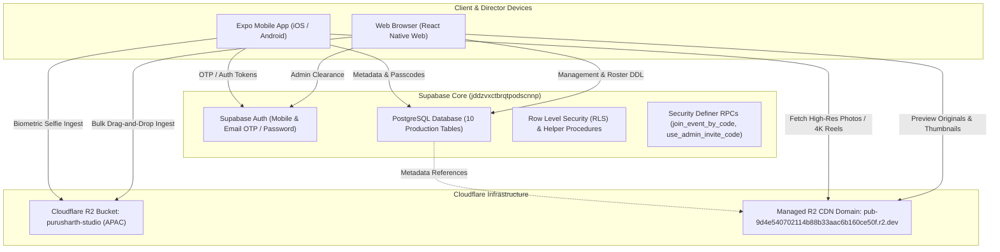

# Purusharth Studio — Complete System Architecture & Operational Guide

> **Brand:** Purusharth Studio — *Your Moments. Your Memories.*  
> **Platform:** React Native (Expo SDK 57) + React Native Web • Supabase (PostgreSQL 15) • Cloudflare R2 (APAC)  
> **Version:** 1.0.0 Production Architecture  
> **Updated:** October 2026

---

## 1. System Architecture Overview

Purusharth Studio is a private, luxury photo & video sharing platform. The application provides two tailored experiences in a single, unified codebase:

1. **Client & Director Portal (Mobile & Web)**: A photography-first gallery experience featuring luxury ivory-and-gold aesthetics, private passcode vault access, AI selfie onboarding for automated facial matching, and 4K cinema lookbooks.
2. **Super Admin Operations Console (Desktop Web)**: A high-density telemetry console for studio directors, production managers, and digital imaging technicians (DITs) to manage events, execute bulk media ingest directly into Cloudflare R2, generate time-expiring client/admin passes, and control role permissions.



---

## 2. Remote Supabase Architecture

The remote database was provisioned fresh on Supabase instance `db.jddzvxctbrqtpodscnnp.supabase.co:5432`.

### 2.1 Database Schema (10 Production Tables)

| Table | Primary Key | Key Columns | Purpose |
| :--- | :--- | :--- | :--- |
| `profiles` | `id (UUID -> auth.users)` | `display_name`, `email`, `phone`, `city`, `avatar_url`, `selfie_url`, `role`, `status` | Extended user identity and biometric metadata. Role is constrained to `super_admin`, `admin`, or `client`. |
| `events` | `id (UUID)` | `title`, `description`, `event_date`, `location`, `cover_url`, `total_photos`, `status` | Studio production events (weddings, galas, commercial shoots). |
| `event_admins` | `id (UUID)` | `event_id`, `admin_id`, `assigned_by`, `assigned_at`, `revoked_at` | Explicit many-to-many role mapping assigning admins to specific events. |
| `event_codes` | `id (UUID)` | `event_id`, `code (UNIQUE)`, `expires_at`, `max_uses`, `use_count`, `status` | Cryptographic passcodes granting client access to event vaults. |
| `event_members` | `id (UUID)` | `event_id`, `user_id`, `source_code_id`, `granted_at`, `status` | Client access roster created upon valid passcode redemption. |
| `collections` | `id (UUID)` | `title`, `description`, `cover_url`, `visibility`, `published_at` | Curated editorial lookbooks and public studio reels. |
| `collection_media` | `id (UUID)` | `collection_id`, `media_id`, `sort_order` | Junction sequencing media assets inside collections. |
| `media` | `id (UUID)` | `event_id`, `uploaded_by`, `object_key`, `url`, `media_type`, `mime_type`, `size_bytes`, `status` | Photo and video asset catalog referencing Cloudflare R2 objects. |
| `admin_invites` | `id (UUID)` | `code (UNIQUE)`, `created_by`, `max_uses`, `use_count`, `status`, `expires_at` | Referral codes allowing new team members to gain `admin` clearance. |
| `audit_logs` | `id (UUID)` | `actor_id`, `action`, `entity_type`, `entity_id`, `metadata (JSONB)` | Tamper-evident audit trail for administrative operations. |

### 2.2 Security Definer Functions & Triggers

1. **`on_auth_user_created` Trigger**:
   - Listens on `auth.users` `AFTER INSERT` and triggers `public.handle_new_user()`.
   - Reads `raw_user_meta_data`. If the email is `admin@purusharthstudio.com` or if no profile exists yet, sets `role = 'super_admin'`.
   - If an `invite_code` is provided in metadata matching an active `admin_invites` record, sets `role = 'admin'` and increments usage count.
   - Otherwise defaults to `role = 'client'`.
2. **`public.join_event_by_code(p_code text)`**:
   - `SECURITY DEFINER` routine allowing authenticated users to redeem event passcodes without granting write permissions to `event_members` or `event_codes`.
   - Verifies code validity, expiration date, and usage limits.
   - Creates the `event_members` link and increments `use_count`.
3. **`public.use_admin_invite_code(p_code text)`**:
   - `SECURITY DEFINER` routine allowing logged-in accounts to elevate their profile to `admin`.
4. **`public.increment_event_photos(p_event_id uuid)`**:
   - Atomic database counter updating `events.total_photos` when new media is ingested.

### 2.3 Verified Seed Data
- **Events:**
  - `The Royal Udaipur Wedding` (`id: 11111111-1111-1111-1111-111111111111`) — 840 photos, City Palace Udaipur.
  - `Oberoi Heritage Gala 2024` (`id: 22222222-2222-2222-2222-222222222222`) — 520 photos, The Oberoi Rajvilas Jaipur.
- **Passcodes:**
  - `UDAIPUR-24` → Unlocks *The Royal Udaipur Wedding*.
  - `OBEROI-GL` → Unlocks *Oberoi Heritage Gala 2024*.
- **Admin Referral Code:**
  - `INVITE-2025` → Elevates account to Event Admin (100 uses max).

---

## 3. Cloudflare R2 Storage Integration

Storage is decoupled from database compute and routed to a dedicated Cloudflare R2 bucket.

### 3.1 Bucket Parameters
- **Bucket Name:** `purusharth-studio`
- **Region / Location:** `APAC` (Asia-Pacific, low latency for India)
- **Public Managed CDN:** `https://pub-9d4e540702114b88b33aac6b160ce50f.r2.dev`
- **CORS Policy:**
  ```json
  [
    {
      "AllowedOrigins": ["*"],
      "AllowedMethods": ["GET", "PUT", "POST", "HEAD", "DELETE"],
      "AllowedHeaders": ["*"],
      "MaxAgeSeconds": 3600
    }
  ]
  ```

### 3.2 Direct REST Upload Engine (`src/services/r2.ts`)
Instead of proxying large RAW camera files through intermediate serverless workers, the client and admin consoles execute direct HTTP `PUT` requests directly against the Cloudflare R2 API:

- **Endpoint:** `https://api.cloudflare.com/client/v4/accounts/${ACCOUNT_ID}/r2/buckets/${BUCKET}/objects/${encodeURIComponent(key)}`
- **Headers:**
  - `Authorization: Bearer ${API_TOKEN}`
  - `Content-Type: ${contentType}`
  - `Content-Length: ${fileSize}`
- **Features:**
  - **Progress Tracking:** Leverages `XMLHttpRequest.upload.onprogress` to stream 0–100% progress events.
  - **Cross-Platform:** Accepts browser `File` / `Blob` on Web and `{ uri, name, type }` on iOS/Android via binary fetch.
  - **Batch Concurrent Worker Pool:** `uploadMediaBatch(files, options)` coordinates multiple uploads with customizable concurrency (default: 3 concurrent streams), tracking item-by-item progress and committing database rows to Supabase `media` in parallel.

---

## 4. Application Routes & Navigation

Navigation is powered by Expo Router with root `Stack` routing:

```
src/app/
├── _layout.tsx           # Root Layout wrapping AuthProvider & Stack Navigation
├── index.tsx             # Client Home: Lookbook, Vault Access, Active Passes
├── login.tsx             # Universal Authentication: Email OTP, Mobile OTP, Admin Login
├── profile.tsx           # Biometric Selfie Onboarding & User Profile Settings
├── event/
│   └── [id].tsx          # Event Photo Gallery: R2 CDN Grid & High-Res Lightbox Modal
└── admin/
    ├── _layout.tsx       # Admin Route Slot
    ├── index.tsx         # Super Admin Dashboard Overview & Operational Telemetry
    ├── events.tsx        # Events Directory & Create Event Modal
    ├── uploads.tsx       # Photo Uploads & Multi-File Drag-and-Drop Ingest
    ├── admins.tsx        # Admins Roster & Generate Invite Code Modal
    └── login.tsx         # Dedicated Super Admin Console Login
```

---

## 5. Screen Highlights & Stitch UI Integration

### 5.1 Client & Director Portal (`/`)
- **Archival Header:** Monogram emblem, client avatar linking to `/profile`, and direct switch button (`⚡ Admin Console`) when authenticated as an admin.
- **Access Event Vault:** Private token input with uppercase formatting, instant validation against Supabase `event_codes`, and feedback banners.
- **Active Passes:** Displays all events the user has unlocked, showing photo counts and "Full Access Granted" status badges.
- **Shared Collections:** Editorial photography showcase with cards for *The Royal Udaipur Highlights* and *Palace Twilight Cinema Still Lookbook*.
- **4K Film Preview Modal:** Integrated cinematic film player modal with ProRes 4444 teaser preview.

### 5.2 Super Admin Console (`/admin`)
- **Master Layout (`AdminLayout.tsx`):**
  - Linear/Stripe high-density aesthetic (`#F9FAFF` background, `#004AC6` primary, `#141B2B` text).
  - Cluster health indicator (`Worker Cluster: 99.8% Healthy`).
  - Search bar with `⌘K` keyboard badge.
  - Storage & archival gauge (`428 GB / 1 TB, 42.8%`).
  - Responsive layout: Fixed desktop sidebar + animated mobile navigation drawer.
- **Dashboard Overview (`/admin`):**
  - 4 KPI telemetry cards (Total Events: 12, Total Photos: 48,293, Total Admins: 18, Total Attendees: 2,847).
  - Ingestion activity chart with day/event toggle and peak volume markers.
  - Live events roster and real-time operational audit log.
- **Photo Uploads & Bulk Ingestion (`/admin/uploads`):**
  - Direct S3/R2 Ingest status banner and target event selector.
  - Multi-file Drag & Drop zone supporting JPEG, PNG, HEIC, WebP, and ZIP archives.
  - Active upload queue table showing progress bars, upload speed (MB/s), SHA hashes, and instant Supabase persistence.
- **Events Directory (`/admin/events`):**
  - Table and Grid view switcher.
  - Search and filter by status (All, Published, Processing, Draft).
  - Create Event Modal with live Supabase database insertion.
- **Admins Directory (`/admin/admins`):**
  - Admin roster with clearance badges, assigned events, and status pills.
  - Generate Admin Invite Code Modal with custom code generator and expiry configuration.

### 5.3 Universal Authentication (`/login`)
- **Email OTP:** Requests 6-digit magic code sent to user email.
- **Mobile OTP:** Phone authentication for on-site wedding guests.
- **Director Console:** Password-authenticated login for studio super admins.
- **Admin Referral Code Support:** Optional field during registration to instantly onboard new photographers.

### 5.4 Biometric Profile Setup (`/profile`)
- Uses `expo-image-picker` with camera capture and photo library access.
- Uploads reference headshots directly to Cloudflare R2.
- Updates `profiles.selfie_url` and `selfie_key` in Supabase for facial indexing.

---

## 6. Environment Configuration (`.env.local`)

| Variable | Description |
| :--- | :--- |
| `EXPO_PUBLIC_SUPABASE_URL` | Supabase Project URL (`https://jddzvxctbrqtpodscnnp.supabase.co`) |
| `EXPO_PUBLIC_SUPABASE_KEY` | Supabase Publishable / Anon API Key |
| `EXPO_PRIVATE_SUPABASE_PASSWD` | Database Administrator Password (used for direct migrations) |
| `CLOUDFLARE_ACCOUNT_ID` | Cloudflare Account ID (`c5b183bb011ad958f341adda9e499c13`) |
| `CLOUDFLARE_API_TOKEN` | Scoped Cloudflare R2 API Token |
| `EXPO_PUBLIC_R2_BUCKET` | R2 Bucket Name (`purusharth-studio`) |
| `EXPO_PUBLIC_R2_PUBLIC_URL` | Managed Public CDN URL (`https://pub-9d4e540702114b88b33aac6b160ce50f.r2.dev`) |

---

## 7. Verification & Run Commands

### 7.1 Verify Cloudflare R2 & Supabase Ingest
Runs end-to-end tests verifying single upload, byte-level public CDN retrieval, Supabase media table creation, and 3-item concurrent batch upload:
```bash
npm run verify:r2
```
*Expected output: `VERIFICATION COMPLETE: ALL 4 TESTS PASSED (100% SUCCESS)`*

### 7.2 Run TypeScript Typecheck
```bash
npx tsc --noEmit
```
*Expected output: Exit code 0, 0 errors.*

### 7.3 Export Production Web Bundle
Compiles the React Native Web static routes for production deployment:
```bash
npx expo export --platform web
```
*Expected output: 11 static routes generated in `dist/`.*

### 7.4 Start Local Development Server
```bash
# Start Web browser session
npx expo start --web

# Start universal dev server (Web, iOS, Android)
npx expo start
```
